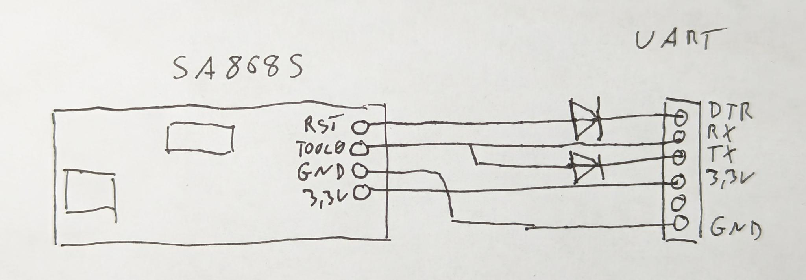
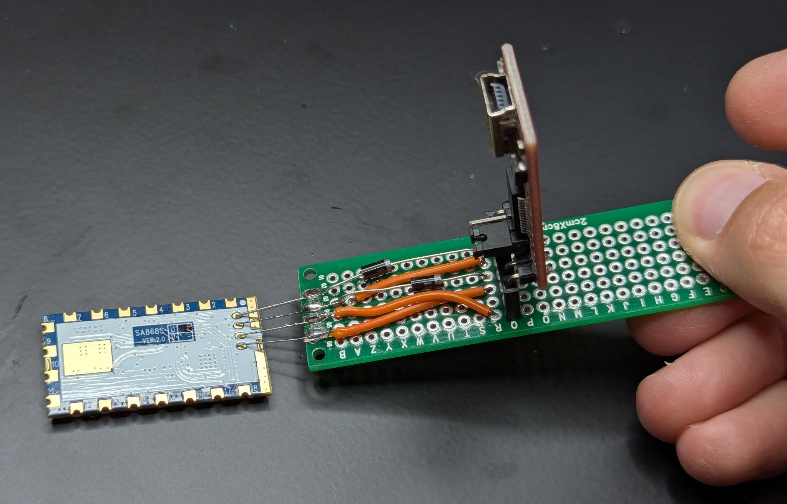

# M17_3310
Mainboard replacement for the Nokia 3310/3330.

> [!CAUTION]
> The board's thickness is 1.0mm. Anything thicker **will not** fit.

## Original mainboard photos

Both photos in the `misc` directory are cropped, so that if you scale them for 108mm height, you should be able to make direct measurements using GIMP or other image editing software.

## Interactive HTML BOM

An interactive HTML version of the Bill of Materials can be found [here](./misc/ibom.html).

## SA868S UHF module firmware

The RF module must be flashed with [OpenRTX](https://github.com/OpenRTX/sa8x8-fw). It can be flashed before or after soldering it in place as the PCB has a hole through which the four programming pads are still accessible.

First of all, download and install the [rl78flash utility](https://github.com/msalau/rl78flash). How you install it, depends on your operating system. 

Now download the [latest OpenRTX firmware](https://github.com/OpenRTX/sa8x8-fw/releases/latest/) for the SA868S UHF module. Here is an example for version 1.4.1:

```
# cd ~/Downloads
# wget https://github.com/OpenRTX/sa8x8-fw/releases/download/v1.4.1/sa8x8-fw-sa868s-uhf.s37
```

We now have the software and firmware in place but we need to build a small programming adapter. You can build one with a UART to USB converter, two 1N5819 diodes, some wire and a small PCB. Here's a diagram showing how it is connected:



Here is how it could look like:



For the four pins, cut and solder the legs of a few resistors to the front of the PCB and bend them to the spacing of the four pins of the SA868S. The rest is quite self-explainatory.

To flash the firmware, plug in the UART to USB converter, hold the board with the four pins to the SA868S module and execute the following command.

__Note: Make sure to jumper the converter to 3.3V!__

```
# cd ~/Downloads/rl78flash/
# flash % ./rl78flash -m 1 -a -v /dev/tty.usbserial-A50285BI ~/Downloads/sa8x8-fw-sa868s-uhf.s37
rl78flash v0.7.0
Protocol configuration: protocol=0, code_block=1024, data_block=1024
Erase code flash
Erase data flash
Read file "/Users/rz01/Downloads/sa8x8-fw-sa868s-uhf.s37"
Write code flash
Write data flash
Verify Code flash
Verify Data flash
Reset MCU
```

In this case, flash mode 1 (_-m 1_) was chosen as the UART to USB converter has a DTR pin. You might need to wire your adapter differently and then select another mode depending on your specific UART to USB board. Please consult this [README](https://github.com/OpenRTX/sa8x8-fw/blob/main/README.md) and this [diagram](https://github.com/msalau/rl78flash/blob/master/hw/rl78s-hw.png) for more information on this.

> [!NOTE]
> The device will appear frozen if the firmware running on the RF module is not OpenRTX.

## Device firmware
See the example firmware [here](https://github.com/M17-Project/M17_3310-fw).

### Flashing over USB
1. Plug in the USB cable.
2. Press and hold the *OK* button (large horizontal one with a blue bar, just below the display).
3. Press the power button at the top of the device.
4. Release the *OK* button.

The device should enter USB DFU mode and should be recognized by CubeProgrammer.
